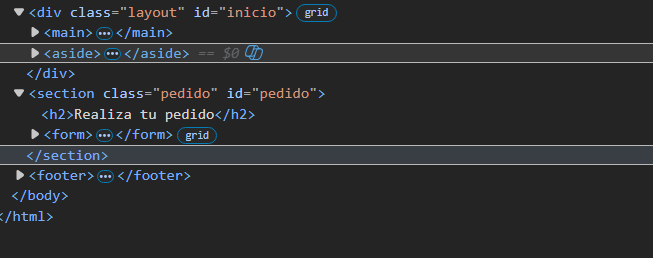
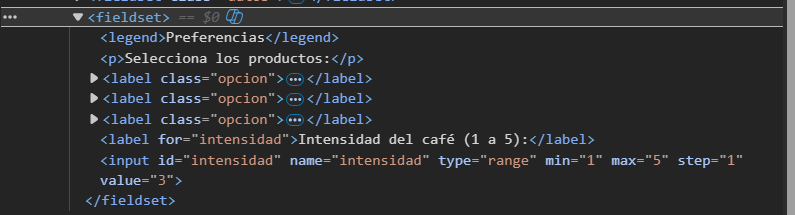
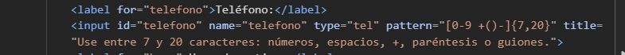
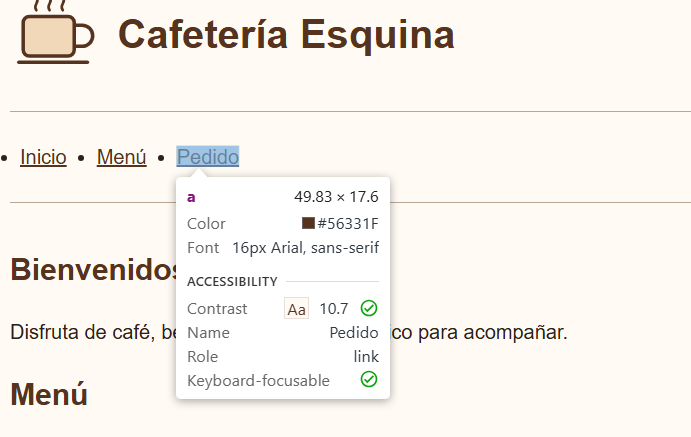
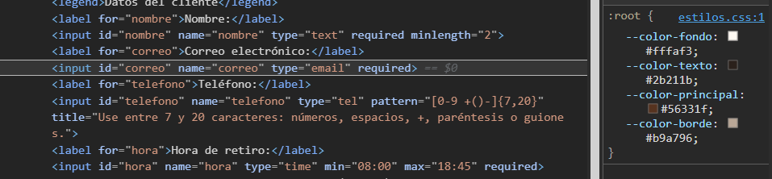
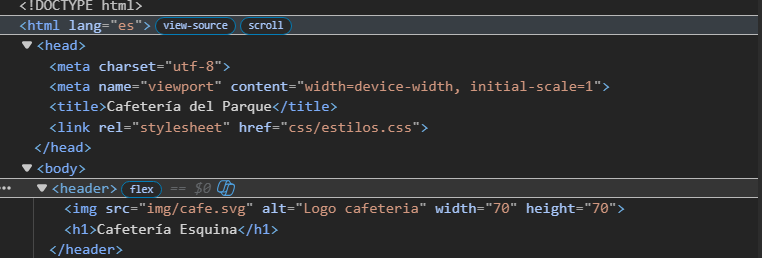
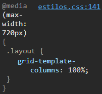
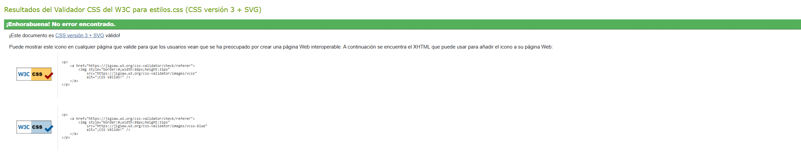
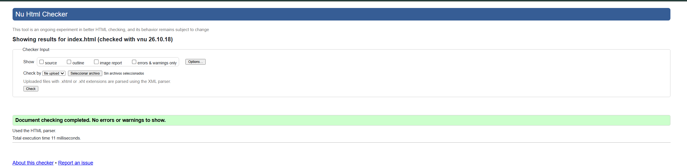
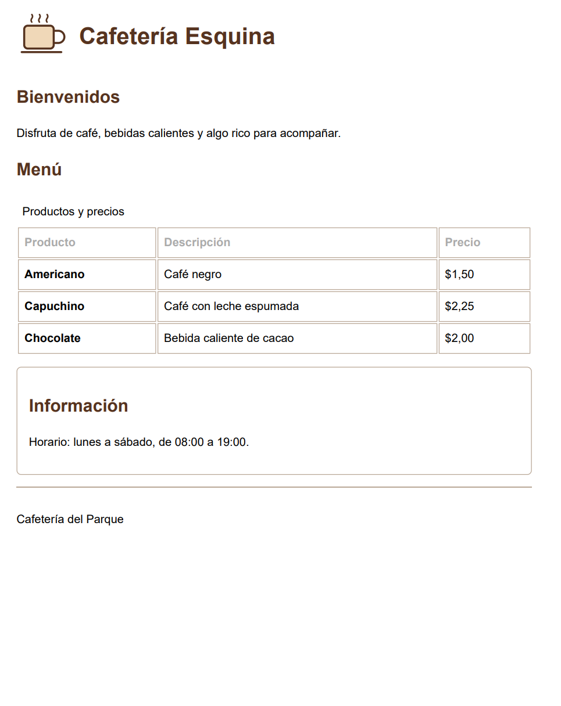

# Informe de auditoría: página del N.º de lista 24

**Auditor:** N.º de lista 25, Michael Yumbla

**Compañero auditado:** N.º de lista 24, Villalta

**Página revisada:** [Pegar aquí el link de GitHub Pages de Villalta]

**Repositorio:** [Pegar aquí el link del repositorio de GitHub de Villalta]

**Fecha de la sesión:** 22/10/2026

## 1. Tu ficha

| N.º de lista | Temática | Campos especiales del formulario | Breakpoint principal | Restricción especial |
|---|---|---|---|---|
| 24 | Cafetería local | Rango numérico (`range`) | 720 px | Hoja de estilos para impresión que oculte la navegación y el formulario |

## 2. Qué esperaba encontrar y qué encontré

| Requisito | Qué esperaba encontrar | Qué encontré |
|---|---|---|
| Base 1: estructura semántica | Que tenga cabecera (`header`), menú (`nav`), contenido principal (`main`), al menos dos secciones (`section` o `article`) con su propio título, barra lateral (`aside`) y pie de página (`footer`), y que los títulos bajen en orden (`h1`, `h2`) sin saltarse niveles. | Tiene esas etiquetas y los títulos bajan de `h1` a `h2` sin saltos, pero la sección del formulario de pedidos (`#pedido`) quedó afuera de `<main>` (hallazgo 1). |
| Base 2: formulario | Al menos 5 campos con su `label`, tipos de input correctos, validación nativa (`required`, `pattern`, `min`/`max`) y agrupados con `fieldset` y `legend`. | Tiene 7 controles y usa `fieldset` y `legend`, pero el grupo de checkboxes usa un `
` suelto en vez de su propio `fieldset`/`legend` (hallazgo 2) y el teléfono esconde la instrucción del formato en `title` en lugar de usar texto visible con `aria-describedby` (hallazgo 3). |
| Base 3: tabla | Una tabla con `caption`, `thead`, `tbody` y encabezados `th` con atributo `scope`. | La tabla del menú tiene `caption`, `thead`, `tbody`, `scope="col"` en las columnas y `scope="row"` en los productos. Cumple. |
| Base 4: layout responsive | CSS Grid para la estructura general, Flexbox para un componente interno y que no aparezca scroll horizontal en 360 px. | Usa Grid en `.layout` y `form`, y Flexbox en `header` y `nav ul`. En 360 px no genera scroll horizontal. Sin embargo, el diseño está hecho con `max-width: 720px` (Desktop-first) en lugar del enfoque Mobile-first (hallazgo 7). |
| Base 5: variables CSS y contraste | Colores declarados como variables `--color-...` en `:root` y contraste mínimo de 4.5:1 en texto normal. | Define 4 variables en `:root` con buen contraste en el texto principal, pero usa colores fijos como `white`, `blue` y `black` fuera de las variables, y el borde `--color-borde` (`#b9a796`) no alcanza el contraste mínimo de 3:1 en controles (hallazgo 5). |
| Base 6: teclado y foco | Navegación completa con teclado (`Tab`), enlace para saltar al contenido y foco visible en todos los elementos interactivos. | Se puede recorrer con `Tab` y tiene borde azul en `:focus`, pero le falta el enlace de saltar al contenido principal y los enlaces del menú miden menos del mínimo de 24×24 px de WCAG 2.2 (hallazgo 4). |
| Base 7: validadores | Cero errores en el validador HTML del W3C y en el validador CSS. | El HTML y el CSS pasan los validadores del W3C sin errores de sintaxis (revisar que en la línea 8 de `estilos.css` esté el selector universal `*`). Cumple. |
| Base 8: imágenes con alt | Todas las imágenes con atributo `alt` adecuado. | La imagen `img/cafe.svg` tiene `alt="Logo cafeteria"`, pero le falta la tilde y repite información junto al `h1`; además hay inconsistencia en el nombre del local entre el `title`/`footer` y el `h1` (hallazgo 6). |
| Ficha: temática y ficha.md | Contenido sobre una cafetería local y archivo `docs/ficha.md` con los datos de la fila 24. | El contenido trata sobre una cafetería (menú, horarios y pedidos) y `docs/ficha.md` incluye la tabla de la fila 24. Cumple. |
| Ficha: rango numérico (range) | Un campo `<input type="range">` en el formulario con su etiqueta y límites `min`/`max`. | Incluye `#intensidad` con `type="range"`, `min="1"`, `max="5"`, `step="1"` y su `<label>`. Pero no muestra ni indica al usuario qué valor numérico tiene seleccionado actualmente ni qué significa 1 o 5 (hallazgo 3). |
| Ficha: breakpoint de 720 px | Una media query principal en 720 px que adapte el layout. | Tiene `@media (max-width: 720px)` que pasa `.layout` a una columna, aunque usa enfoque de escritorio a móvil en vez de Mobile-first (hallazgo 7). |
| Ficha: hoja de estilos para impresión | Reglas de impresión que oculten la navegación y el formulario. | Incluye `@media print` al final de `estilos.css` con `nav, .pedido { display: none; }` que oculta el menú y la sección del formulario al imprimir. Cumple. |
| Historial de commits | Commits frecuentes y descriptivos por etapas, no una sola subida al final. | [Revisar en su GitHub cuántos commits tiene y anotar aquí, por ejemplo: "Tiene X commits en el repositorio"]. |

## 3. Informe de auditoría

| N.º | Requisito | Ubicación (archivo y línea o selector) | Hallazgo | Norma que incumple | Evidencia | Severidad (alta, media, baja) |
|---|---|---|---|---|---|---|
| 1 | Base 1: estructura semántica | `index.html`, líneas 54 y 63: cierre `</main>` y `<section class="pedido" id="pedido">` | La etiqueta `<main>` se cierra en la línea 54 y deja toda la sección del formulario (`<section class="pedido" id="pedido">`) afuera del contenido principal, directamente dentro del `<body>`. Como el formulario de pedidos es parte central de la página, debe estar dentro de `<main>`. | WHATWG HTML, elemento `main`. WCAG 2.2, criterio 1.3.1 (Información y relaciones). | Estructura del DOM en DevTools con `section#pedido` fuera de `main`.  | Alta |
| 2 | Base 2: formulario accesible | `index.html`, líneas 83 a 90: `<fieldset>` de Preferencias y `
Selecciona los productos:
` | Los tres checkboxes de productos tienen como título un párrafo suelto (`
Selecciona los productos:
`) y están mezclados en el mismo `<fieldset>` que el rango de intensidad. Un lector de pantalla no anuncia ese `
` como nombre del grupo de casillas; los checkboxes necesitan su propio `<fieldset>` con `<legend>Selecciona los productos</legend>`. | WCAG 2.2, criterios 1.3.1 (Información y relaciones) y 3.3.2 (Etiquetas o instrucciones). | Árbol de accesibilidad de los checkboxes sin grupo propio.  | Alta |
| 3 | Base 2 y Ficha 24: instrucciones del formulario y campo `range` | `index.html`, líneas 74-75 (`input#telefono`) y líneas 92-93 (`input#intensidad`) | En el campo teléfono, la instrucción del `pattern` está escondida en el atributo `title`, que no se puede ver en pantallas táctiles ni con teclado. Además, en el campo especial `type="range"` (`#intensidad`), no hay texto de ayuda con `aria-describedby` que explique qué representa la escala de 1 a 5 (ej. 1 = suave, 5 = extra fuerte). | WCAG 2.2, criterio 3.3.2 (Etiquetas o instrucciones). Ficha 24: rango numérico accesible. | Código de `#telefono` y `#intensidad` sin `aria-describedby`.  | Media |
| 4 | Base 6: teclado, foco y tamaño de controles | `css/estilos.css`, líneas 35 a 44 (`nav ul`, `a`) y líneas 119 a 122 (`.opcion`) | Los enlaces del menú de navegación (`Inicio`, `Menú`, `Pedido`) y las etiquetas `.opcion` de los checkboxes no tienen `padding` ni altura mínima, por lo que miden alrededor de 18 px de alto. Además, falta el enlace al inicio del `<body>` para saltar directamente al contenido principal con el teclado. | WCAG 2.2, criterios 2.5.8 (Tamaño del objetivo: mínimo 24×24 px) y 2.4.1 (Evitar bloques). | Inspector de DevTools mostrando la altura menor a 24 px en los enlaces del menú.  | Media |
| 5 | Base 5: variables CSS y contraste | `css/estilos.css`, líneas 4 (`--color-borde`), 49 (`blue`), 79, 96 y 128 (`white`) | Aunque declaró variables en `:root`, sigue usando colores fijos (`blue` en el foco, `white` en la tabla, cabecera de tabla y botón) sin guardarlos en variables `--color-...`. Además, la variable `--color-borde: #b9a796` sobre el fondo `#fffaf3` tiene un contraste de 2.19:1, menor al mínimo de 3:1 para bordes de componentes. | Requisito base 5 (variables `--color-...`). WCAG 2.2, criterio 1.4.11 (Contraste no textual). | Reglas CSS en DevTools con colores fijos y contraste del borde.  | Media |
| 6 | Base 8: imagen con `alt` y coherencia de títulos | `index.html`, líneas 6 (`<title>`), 10 (``), 11 (`<h1>`) y 100 (`<footer>`) | El nombre del negocio cambia según la parte de la página: en `ficha.md` y en el `<h1>` se llama "Cafetería Esquina", pero en el `<title>` de la pestaña y en el `<footer>` dice "Cafetería del Parque". Además, la imagen del logo tiene `alt="Logo cafeteria"` (sin tilde y redundante al estar junto al `<h1>`). | WCAG 2.2, criterios 2.4.2 (Titulado de páginas) y 1.1.1 (Contenido no textual). | Comparación entre `<title>`, `<h1>`, `` y `<footer>`.  | Baja |
| 7 | Base 4 y Ficha 24: breakpoint de 720 px | `css/estilos.css`, líneas 51-55 (`.layout`) y línea 136 (`@media (max-width: 720px)`) | El diseño se programó primero para pantalla grande (`grid-template-columns: 2fr 1fr`) y usa `@media (max-width: 720px)` con `100%` para reducirlo en móvil, en lugar de construir primero el diseño móvil de 1 columna y usar `@media (min-width: 720px)` (Mobile-first) como indica la metodología vista en clase. | Metodología CSS Responsive (Mobile-first) y Ficha 24 (breakpoint 720 px). | Regla `@media (max-width: 720px)` en `estilos.css`.  | Baja |

## 4. Evidencia de los validadores y del teclado

**Validador CSS (W3C)**

**Validador HTML (Nu Html Checker)**

**Prueba de impresión  y foco con teclado**

## 5. Sugerencias menores

- Al formulario `<form>` le falta definir los atributos `action="#"` y `method="post"` para seguir la estructura estándar de envío.
- En el campo `<input type="tel">`, convendría agregar el atributo `required` y `autocomplete="tel"` para mantener consistencia con el resto de los datos del cliente.
- En la regla `:focus` de `estilos.css` (línea 46), sería mejor usar `:focus-visible` de forma general para no limitar el contorno únicamente a `a`, `input` y `button`.

## 6. Fuentes

- WHATWG HTML Living Standard, elemento `main`: https://html.spec.whatwg.org/multipage/grouping-content.html#the-main-element
- WCAG 2.2, Criterio 1.3.1 (Info and Relationships): https://www.w3.org/WAI/WCAG22/Understanding/info-and-relationships.html
- WCAG 2.2, Criterio 3.3.2 (Labels or Instructions): https://www.w3.org/WAI/WCAG22/Understanding/labels-or-instructions.html
- WCAG 2.2, Criterio 2.5.8 (Target Size Minimum): https://www.w3.org/WAI/WCAG22/Understanding/target-size-minimum.html
- WCAG 2.2, Criterio 1.4.11 (Non-text Contrast): https://www.w3.org/WAI/WCAG22/Understanding/non-text-contrast.html
- WCAG 2.2, Criterio 2.4.1 (Bypass Blocks): https://www.w3.org/WAI/WCAG22/Understanding/bypass-blocks.html
- WCAG 2.2, Criterio 2.4.2 (Page Titled): https://www.w3.org/WAI/WCAG22/Understanding/page-titled.html
- MDN Web Docs, `<input type="range">`: https://developer.mozilla.org/es/docs/Web/HTML/Element/input/range
- Validador HTML W3C (Nu): https://validator.w3.org/nu/
- Validador CSS W3C: https://jigsaw.w3.org/css-validator/