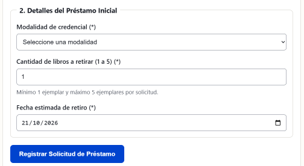
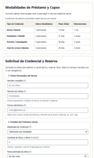
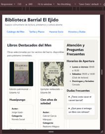
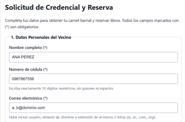

# Respuestas a la auditoría

**Compañero auditado:** N.º de lista 25, Michael Yumbla
**Auditora:** N.º de lista 26, Cristina Loja
**Fecha de revisión:** 24/10/2026

## 1. Respuestas a los hallazgos reportados

| N.º de hallazgo | Decisión (acepta o refuta) | Justificación con la norma | Evidencia antes y después | Commit |
|---|---|---|---|---|
| 1 | Refuta fecha; Acepta ayuda | Según WHATWG, el atributo `min` de `<input type="date">` exige el formato estático `YYYY-MM-DD`. Automatizarlo requiere JavaScript, prohibido en la práctica. Se acepta la falta de texto de ayuda exigido por WCAG 2.2 (3.3.2 Etiquetas o instrucciones). | **Antes:**  **Después:**  | `117dfc5` |
| 2 | Acepta | Incumple WHATWG HTML. Cada fila representa un elemento individual, por lo que corresponde usar `scope="row"` en lugar de `rowgroup`. | **Antes:**  **Después:**  | `12133fd` |
| 3 | Acepta | Incumple Criterio 1.4.10 (Reflow) de WCAG 2.2. Grid requiere declarar `min-width: 0` para evitar desbordamiento horizontal en 360 px. | **Antes:**  **Después:**  | `0eb97f7` |
| 4 | Acepta | El breakpoint de 720 px de la Ficha 25 generaba conflictos en la cuadrícula sin las reglas de contención de ancho máximo general. | **Antes:**  **Después:**  | `33830a2` `0ac1c44` |
| 5 | Acepta | Error en la cascada CSS; se aplicó la clase del contenedor `.libro-card` al texto, causando anidamiento visual. Se resolvió estructurando el ancho máximo de la tarjeta. | **Antes:**  **Después:**  | `24e98c9` |
| 6 | Acepta | El patrón era demasiado permisivo. Se requiere un `pattern` estricto sin repeticiones de caracteres según la Ficha 25 y WHATWG. | **Antes:**  **Después:**  | `730262e` |

## 2. Problemas adicionales no detectados por el auditor 

1. **Tamaño de objetivo interactivo insuficiente en `
`:** Durante la aplicación de correcciones, identifiqué que los elementos `
` del acordeón de Dudas Frecuentes no tenían altura definida. Su área interactiva era menor a 24 píxeles de alto en dispositivos móviles, lo cual incumple con el Criterio 2.5.8 Tamaño del objetivo mínimo de WCAG 2.2. Se corrigió añadiendo `min-height: 24px` y padding en el archivo CSS.